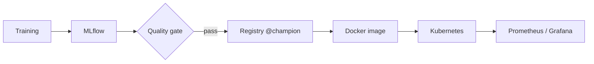

# Jet prediction

LHC sends paquets of proton 40 milions times by seconds. Each collision produce many particles measured by sensors.But it's too many data to save : the majority of data is lost. So the idea is to construct a system who choses which collisions to keep in real time.This decision need to be done in microseconds.
When particles are produced with a collision, there are not observed direclty, there are fragmented in packs of particles called jets. By studying the form and the structure of this jet, we can deduce which type of particle it is.


## 1. The objective

The objective is to predict which type of particle is produced by the simultaed jet from our dataset. The idea is to keep in mind the importance of latence in our model construction.

## 2. The dataset

We we will use the dataset hls4ml composed of simulated jets dispattched between 5 classes depending on their particle origin : gluon (g), quark léger (q), boson W (w), boson Z (z) et quark top (t). We have 830 000 data with each jet described by 16 features that sums up their form : mass,intern structure, number of particles...

## 3. The model

We will create a simple MLP model. We don't need a complex Transformer or CNN. Construction of a complex model isn't the goal of this project.
We can alreayd some hypothesis : our model will confuse gluon/quart and bosonsW/bosonsZ because of their similiraity in their structure.

## 4. Results

76.7% accuracy and 0.94 macro AUC on the test set, consistent with validation (76.8%). The confusion matrix confirmed the gluon/quark confusion (14% each way), but not the W/Z one: W and Z jets are rarely mistaken for each other, and are much more often classified as light quarks (17% and 15%).

The top quark is the best recognised class (84% recall). It is the heaviest particle of the five and its jets have a richer internal structure, which makes them easier to identify.

## 5. How it works



Training runs are tracked with MLflow. The evaluation script registers each new model, but only promotes it to `champion` if its test accuracy is above a threshold. The model is packaged together with its scaler, so the API can't apply the wrong preprocessing.

The API is built with FastAPI, containerised with Docker and deployed on Kubernetes (kind locally). On every push to `main`, GitHub Actions retrains the model, runs the tests, builds the image, pushes it to GHCR, and deploys it on a temporary kind cluster to check that it actually starts and answers. So the published model is not the one from my laptop: each image can be traced back to the commit that built it.

## 6. Monitoring


There are no labels in production, so accuracy can't be measured live. Besides latency and errors, I track the distribution of predicted classes and the average confidence. The confidence stays around 0.77, very close to the test accuracy, so it's a useful drift signal: if it drops, something changed in the data, even if the API still answers fast and without errors.

## 7. Inference benchmark

Grafana showed a few milliseconds of inference latency for a very small network, so I measured where the time was going (single thread, median):

| Method | 1 jet | 1000 jets |
|---|---|---|
| MLflow pyfunc (as served) | 1.94 ms | 2.33 ms |
| PyTorch network only | 0.048 ms | 0.254 ms |
| ONNX Runtime FP32 | 0.013 ms | 0.222 ms |
| ONNX Runtime INT8 | 0.019 ms | 0.191 ms |

More than 97% of the time is spent around the network (schema checks, pandas, scikit-learn), not in it. Exporting the scaler and the network as a single ONNX graph gives the same predictions and is about 150x faster for one jet. INT8 quantisation wasn't worth it: slower on small batches and 0.3 points of accuracy lost.

I didn't put ONNX in the API: it would save about 2 ms per request, which isn't worth the extra complexity at this traffic level.

## 8. Run it

```bash
uv sync
uv run python -m jetpred.train
uv run python -m jetpred.evaluate
uv run uvicorn jetpred.serve:app --port 8000
```

Kubernetes manifests are in `k8s/`, and the inference benchmark is in `scripts/benchmark.py`.

## 9. Next steps

- Serve the ONNX model directly from the API.
- Use a shared MLflow server instead of a local SQLite database.
- Deploy with GitOps (Argo CD) instead of applying manifests by hand.